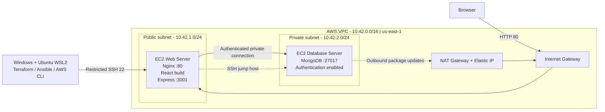
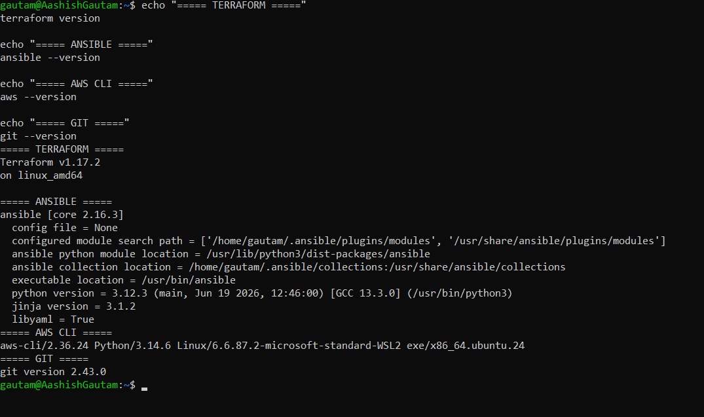
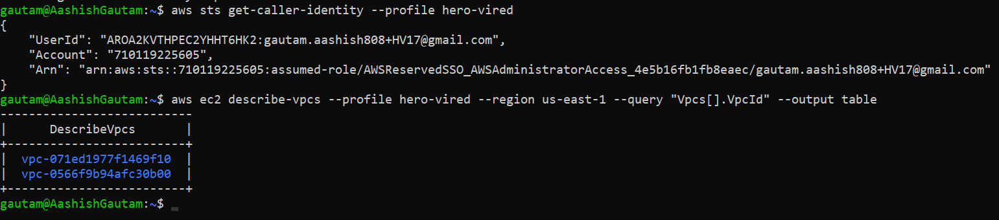
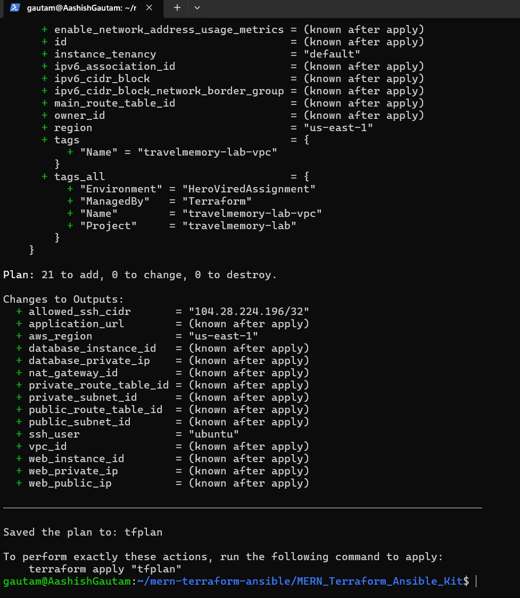
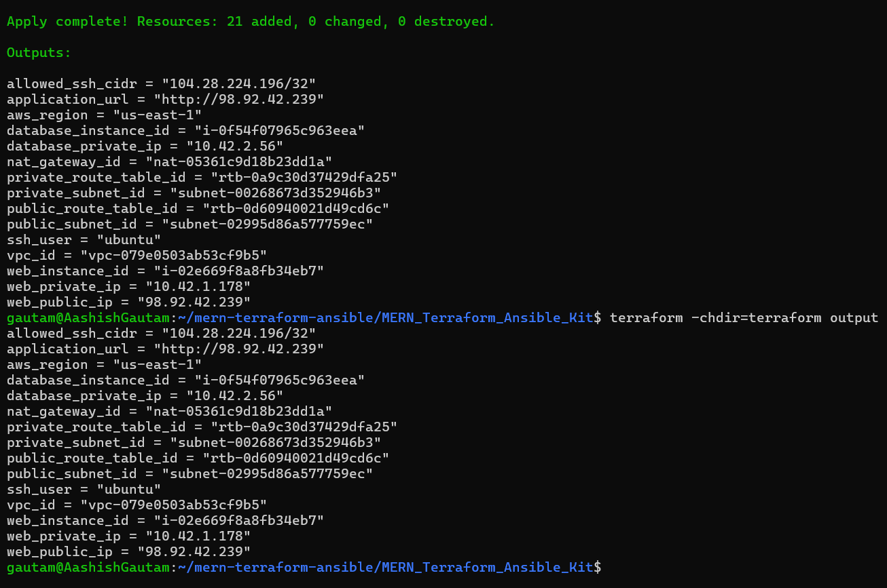
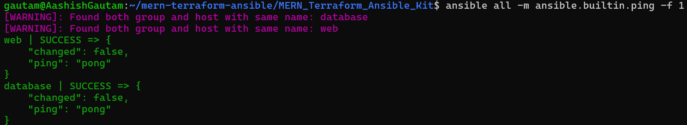
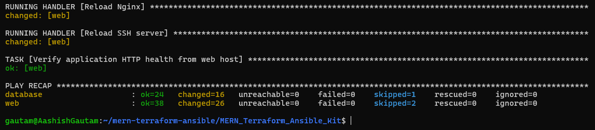

# TravelMemory MERN Deployment on AWS with Terraform & Ansible

**Hero Vired | DevOps / Cloud Automation Graded Assignment | November 2026**

[](terraform/)
[](ansible/)
[](https://aws.amazon.com/)
[](https://github.com/UnpredictablePrashant/TravelMemory)

**Repository:** [aashish579/MERN-Stack-Ansible-Terraform](https://github.com/aashish579/MERN-Stack-Ansible-Terraform)  
**Detailed assignment report:** [TravelMemory Terraform & Ansible Deployment Report (Word)](TravelMemory_Terraform_Ansible_Deployment_Report.docx)  
**Application source:** [UnpredictablePrashant/TravelMemory](https://github.com/UnpredictablePrashant/TravelMemory)

## 1. Project overview

This project automates the deployment of the **TravelMemory MERN application** on Amazon Web Services. **Terraform** provisions a two-tier AWS network and compute environment; **Ansible** installs, configures, secures, and verifies the application and database services.

The public EC2 instance hosts the React frontend, Nginx reverse proxy, and Node.js/Express API. A separate EC2 instance runs MongoDB in a **private subnet with no public IPv4 address**. The backend connects to MongoDB over the VPC's private network.

### Implementation results

| Checkpoint | Observed result |
|---|---|
| Initial Terraform provisioning | **21 resources added**, 0 changed, 0 destroyed |
| EC2 architecture | 1 public web instance + 1 private MongoDB instance |
| Ansible deployment | **0 failed / 0 unreachable** on both hosts |
| Ansible verification | Web: **4 OK**; database: **5 OK**; no failures |
| Database security | Anonymous MongoDB read **rejected** |
| API create operation | `POST /trip` returned **HTTP 201 Created** |
| Data retrieval | Saved **Deployment Test Trip** displayed on the React homepage and detail page |

> **Demo endpoint at the time of testing (20 November 2026):** `http://3.230.171.2`  
> This is an **ephemeral EC2 public IPv4 address** and may change or become unavailable after an instance restart or lab shutdown. The repository and screenshots are the persistent submission evidence.

## 2. Architecture



**Request flow:** Browser → Nginx on the public web instance → Express API (`/trip`, `/health`) on localhost port `3001` → authenticated MongoDB connection on the private instance → response displayed by React.

**Network isolation:** The database has no public IP. Its security group permits MongoDB (`27017`) and SSH (`22`) only from the web instance's security group. Port `3001` is not publicly exposed.

## 3. Technology stack

| Layer | Technology | Purpose |
|---|---|---|
| Cloud infrastructure | AWS VPC, EC2, Internet Gateway, NAT Gateway, Elastic IP | Public/private network and compute |
| Infrastructure as code | Terraform | Repeatable provisioning of AWS resources |
| Configuration management | Ansible | Package installation, configuration, security, deployment |
| Frontend | React | TravelMemory user interface |
| Backend | Node.js + Express | REST API and application logic |
| Database | MongoDB Community 8.0 | Persistent trip records |
| Web server | Nginx | Serves React and proxies API requests |
| Service management | systemd | Runs and restarts the backend |
| Security / management | Security groups, UFW, SSH keys, IAM, SSM, Ansible Vault | Restricted access and encrypted configuration |
| Control machine | Ubuntu 24.04 on Windows WSL2 | Runs Terraform, Ansible, AWS CLI and Git |

## 4. Repository structure

```text
MERN-Stack-Ansible-Terraform/
├── README.md
├── TravelMemory_Terraform_Ansible_Deployment_Report.docx
├── QUICK_START.txt
├── ansible.cfg
├── terraform/
│   ├── providers.tf          # AWS provider and Ubuntu AMI lookup
│   ├── network.tf            # VPC, subnets, gateways, routes
│   ├── compute.tf            # Web/database EC2 instances and SSH key pair
│   ├── security.tf           # Security groups
│   ├── iam.tf                # EC2 IAM roles, profiles, SSM access
│   ├── variables.tf          # Configurable parameters
│   ├── outputs.tf            # EC2 IDs, IPs, application URL
│   └── terraform.tfvars.example
├── ansible/
│   ├── site.yml              # Database and web deployment plays
│   ├── verify.yml            # Service, API and MongoDB security checks
│   ├── group_vars/all.yml
│   ├── tasks/{database,web}.yml
│   └── templates/            # Nginx, systemd, environment and Mongo users
├── scripts/
│   ├── prepare.sh            # Local key and initial Terraform variables
│   ├── generate_inventory.py # Terraform outputs -> SSH and Ansible inventory
│   ├── create_secrets.sh     # Encrypted Ansible Vault values
│   ├── test_app.py           # HTTP and trip persistence smoke test
│   └── cleanup.sh            # Guarded teardown
├── docs/                     # Troubleshooting, validation and checklists
├── evidence/
│   └── screenshots/          # Actual deployment and application screenshots
└── generated/                # Local-only inventory and secrets (Git ignored)
```

The MERN application is **cloned from the upstream TravelMemory repository by Ansible**. This repository contains the infrastructure and deployment automation rather than a duplicate copy of the application source.

## 5. How to deploy (fresh environment)

> These steps are for a **new deployment**. The assignment environment has already been provisioned and verified; **do not rerun `terraform apply` on the existing deployment without reviewing the plan**, as a newer Ubuntu AMI can trigger EC2 replacement.

### Prerequisites

- AWS account with permissions for EC2, VPC, IAM, Elastic IP, NAT Gateway and SSM.
- Configured AWS CLI SSO profile (`hero-vired` in this lab).
- Terraform, Ansible, Git, Python 3, SSH and curl on Ubuntu/WSL.
- Ansible collection specified in `ansible/requirements.yml`.

### Step A — Authenticate and prepare local configuration

```bash
# Run from the project root in Ubuntu WSL, not Windows PowerShell.
export AWS_PROFILE=hero-vired
export AWS_REGION=us-east-1
export AWS_DEFAULT_REGION=us-east-1
aws sso login --profile hero-vired --use-device-code
aws sts get-caller-identity

# First-time setup: reuse existing SSH keys if already created.
bash scripts/prepare.sh
```

`prepare.sh` prepares the local SSH key and `terraform/terraform.tfvars` with a restricted public IPv4 `/32`. Never commit the private key or generated variables.

### Step B — Provision infrastructure with Terraform

```bash
terraform -chdir=terraform init
terraform -chdir=terraform fmt -check
terraform -chdir=terraform validate
terraform -chdir=terraform plan -out=tfplan
# Inspect the plan before continuing.
terraform -chdir=terraform apply tfplan
terraform -chdir=terraform output
```

### Step C — Prepare Ansible and deploy

```bash
python3 scripts/generate_inventory.py
bash scripts/create_secrets.sh
ansible-galaxy collection install -r ansible/requirements.yml

# Connectivity: both hosts should return pong.
ansible all -m ansible.builtin.ping -f 1

# Database first, then web tier.
ansible-playbook ansible/site.yml \
  --vault-password-file generated/.vault_pass
```

The playbook configures MongoDB users and authorization, host firewalls, SSH hardening, Node.js dependencies, React production build, Nginx and the `travelmemory.service` systemd unit.

### Step D — Verify services and application

```bash
ansible-playbook ansible/verify.yml \
  --vault-password-file generated/.vault_pass

WEB_IP="$(terraform -chdir=terraform output -raw web_public_ip)"
echo "http://$WEB_IP"
python3 scripts/test_app.py --url "http://$WEB_IP"
```

`verify.yml` checks the web services and HTTP health endpoint, authenticates to MongoDB, and confirms that an unauthenticated database read is denied. `test_app.py` is provided for an HTTP create/read/list persistence test; running it creates a demo trip.

## 6. Verification and functional evidence

The final observed Ansible verification returned:

```text
PLAY RECAP

database : ok=5  changed=0  unreachable=0  failed=0
web      : ok=4  changed=0  unreachable=0  failed=0
```

A direct API submission also returned:

```text
POST /trip -> HTTP 201 Created
{"message":"Trip added successfully", "trip": {"tripName":"Deployment Test Trip", ...}}
```

The saved trip was subsequently visible in the React homepage and its detail view. This demonstrates **successful API-to-database persistence and frontend retrieval**. A separate browser-form submission had previously timed out; this report does **not** claim that the browser's Add Experience submission was independently verified as successful.

### Working application screenshots

**TravelMemory homepage showing the saved trip**


**Persisted trip details**


### Infrastructure and deployment screenshots

<details>
<summary><strong>Expand: AWS setup, Terraform and Ansible evidence (8 screenshots)</strong></summary>

**Tool versions**



**AWS SSO authentication**



**Terraform initialization and validation**


**Terraform execution plan**



**Terraform apply and outputs**



**Security group update and SSH connectivity**


**Ansible connectivity**



**Ansible deployment recap**



</details>

The [detailed Word report](TravelMemory_Terraform_Ansible_Deployment_Report.docx) contains the implementation narrative, architecture, screenshot captions, results and troubleshooting notes.

## 7. Security measures

- **Public/private separation:** only the web tier is publicly accessible; MongoDB has no public IPv4.
- **Restricted SSH:** the public security group allows port `22` only from the configured `/32` address; database SSH uses the web server as a jump host.
- **Host firewalls:** UFW denies unsolicited inbound connections and explicitly allows required ports.
- **Database authentication:** MongoDB has separate administrator and application users; anonymous reads are rejected.
- **Encrypted secrets:** MongoDB credentials are stored locally in encrypted Ansible Vault files under `generated/`.
- **SSH hardening:** key-based access, password authentication disabled and root login disabled.
- **AWS IAM and SSM:** instance profiles allow management through AWS Systems Manager.
- **Service isolation:** Node.js backend runs as a dedicated non-root service managed by systemd.
- **Git hygiene:** Terraform state, `terraform.tfvars`, private keys, Vault files and generated inventory are excluded by `.gitignore`.

**Scope:** This is a learning/demo environment served over **HTTP**, not HTTPS. It is not intended for sensitive data or production traffic. Production use would require TLS, application authentication, backups, monitoring and stronger availability controls.

## 8. Troubleshooting and operational notes

| Issue encountered | Diagnosis / resolution |
|---|---|
| SSH timed out after a network/IP change | AWS security group and Ubuntu UFW allowed different source IPs; synchronized the rules using SSM |
| EC2 instances stopped unexpectedly | CloudTrail showed an `aws-janitor` stop action in the lab account; instances were restarted for testing |
| Web public IPv4 changed after restart | Refreshed Terraform outputs and regenerated SSH/Ansible inventory |
| Initial browser Add Experience submission failed | Inspected Nginx and backend logs; verified API write independently with `POST /trip` → HTTP 201 |
| Terraform proposed replacing EC2 after a later plan | The Ubuntu AMI data source uses `most_recent = true`; review plans and pin an AMI before future updates |

**Cost control:** EC2, NAT Gateway, Elastic IP and storage may incur charges. After assessment and evidence capture, use `bash scripts/cleanup.sh` only when the infrastructure and database contents are no longer needed. Destruction is irreversible for instance-local data.

## 9. Submission deliverables

- [x] Terraform scripts for VPC, public/private subnets, gateways, routing, EC2, security groups and IAM.
- [x] Ansible playbooks for web and database deployment.
- [x] MongoDB authorization and security verification.
- [x] Working HTTP API create operation and persisted trip displayed in React.
- [x] Actual Terraform, Ansible and application screenshots.
- [x] Detailed implementation report in the repository root.
- [x] GitHub repository URL included in the report and README.

**GitHub repository:** https://github.com/aashish579/MERN-Stack-Ansible-Terraform.git

**Submission:** Upload the repository URL (or the linked Word report) through Vlearn, as specified in the assignment instructions.

---

**Author:** Aashish Gautam  
**Project:** TravelMemory MERN Application Deployment with Terraform and Ansible  
**Date of recorded validation:** 20 November 2026
